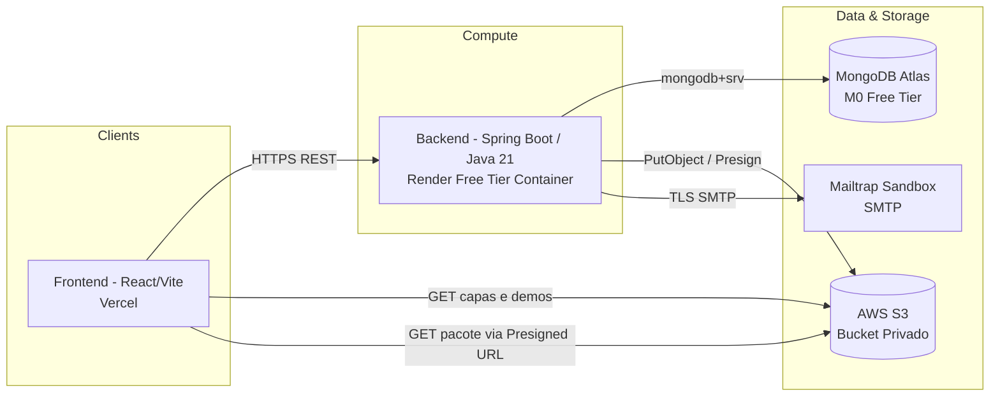

# AGENT_CONTEXT.md — Sonic Lab Backend

> **Documento de Continuidade Operacional para Agentes de IA e Engenharia**  
> **Última atualização:** 26/11/2026  
> **Status do projeto:** Fases 1-5 concluídas. Build, testes (78/78) e E2E em container Docker verificados. CVE-2026-114938 mitigada com pin de tag Docker.

---

## 1. Visão Geral do Projeto

O **Sonic Lab** é um marketplace e ecossistema digital voltado para produtores musicais, beatmakers e criadores de áudio comercializarem e consumirem *Sound Kits* (drum kits, sample packs, loops, presets e one-shots).

### Tecnologias Principais

| Componente | Stack Tecnológica |
|---|---|
| **Backend** | Java 21, Spring Boot 4.1.1, Gradle 9.7.1 (Wrapper), Spring Security, Spring Data MongoDB, SpringDoc OpenAPI 3.1.1 |
| **Frontend** | React + Vite (repositório GitHub separado) |
| **Banco de Dados** | MongoDB (Local via Docker Compose em dev; MongoDB Atlas em prod) |
| **Armazenamento de Arquivos** | Local filesystem (dev) / AWS S3 via AWS SDK 2.56.0 (prod) |
| **Processamento de Áudio** | JAVE 3.5.0 (`ws.schild:jave-all-deps`), JLayer 1.0.1, MP3SPI 1.9.5.4, VorbisSPI 1.0.3.3, JFLAC 1.5.2 |
| **Autenticação** | JWT stateless via Auth0 `java-jwt:4.6.0` com HMAC256 |
| **E-mail** | Spring Boot Starter Mail (SMTP Mailtrap Sandbox) |

### Comunicação entre Serviços

- Frontend (React) consome a API RESTful do backend via HTTPS.
- Uploads de mídia ocorrem em duas etapas:
  1. Frontend envia arquivos brutos aos endpoints de upload dedicados (`/soundkits/uploads/*`).
  2. Backend processa, armazena no storage ativo e devolve referências (URLs públicas ou object keys).
  3. Frontend submete o payload final de cadastro em `POST /soundkits`.
- Downloads de pacotes pagos são protegidos por autenticação JWT e servidos exclusivamente via URLs pré-assinadas (Presigned URLs S3) geradas sob demanda com TTL.

---

## 2. Ambiente e Execução Local

### Requisitos e Versões

- **JDK:** Java 21 (Toolchain configurada no Gradle: `JavaLanguageVersion.of(21)`).
  - **Atenção:** o PATH do Windows pode apontar para Java 8 (`java -version` retorna `1.8.0_461`). O Gradle Wrapper resolve o JDK 21 internamente via toolchain — o build funciona corretamente assim mesmo.
- **Gradle:** 9.7.1 via Gradle Wrapper (`gradlew`, `gradlew.bat`).
- **Build Tool:** Plugin Spring Boot `4.1.1`, Freefair Lombok `9.5.0`, AWS SDK BOM `2.56.0`.

### MongoDB Local & Docker Compose

Arquivo [`docker-compose.yml`](file:///C:/Users/T-GAMER/Documents/Programacao/SONIC_LABfiles/SONIC_LAB/sonic-lab-back-end/docker-compose.yml):
- Serviço `mongodb`: imagem `mongo:latest`, porta mapeada `27017:27017`.
  - Usuário root: `admin`, senha: `password`, database: `soniclab_db`.
  - Volume persistente: `mongo_data`.
- Serviço `mongo-express`: imagem `mongo-express:latest`, porta mapeada `8081:8081`.

### Armazenamento Local

- Controlado por `storage.type=local` (implementação [`LocalStorageService`](file:///C:/Users/T-GAMER/Documents/Programacao/SONIC_LABfiles/SONIC_LAB/sonic-lab-back-end/src/main/java/com/soniclab/soniclabbackend/soundkit/storage/LocalStorageService.java)).
- Diretório padrão: `./uploads` (ignorado no `.gitignore`).
- Base URL: `http://localhost:8080/uploads/`.
- Mapeamento estático ativo via [`WebStorageConfig`](file:///C:/Users/T-GAMER/Documents/Programacao/SONIC_LABfiles/SONIC_LAB/sonic-lab-back-end/src/main/java/com/soniclab/soniclabbackend/soundkit/storage/WebStorageConfig.java) (anotado com `@ConditionalOnProperty(name = "storage.type", havingValue = "local", matchIfMissing = true)`).

### Comandos de Execução e Testes

```powershell
# Subir infraestrutura de banco de dados
docker compose up -d

# Executar a aplicação localmente
./gradlew bootRun

# Executar a suíte de testes automatizados
./gradlew clean test

# Gerar o artefato executável de produção
./gradlew bootJar
```

---

## 3. Arquitetura do Backend

### Organização de Pacotes

```
com.soniclab.soniclabbackend
├── SonicLabBackEndApplication.java    # Ponto de entrada (@SpringBootApplication, @EnableAsync)
├── config/
│   ├── MongoConfig.java               # Habilita auditoria e registra MongoCustomConversions
│   ├── MongoConverter.java            # Interface base para conversores customizados
│   ├── OpenAPIConfig.java             # Documentação OpenAPI/Swagger 3.1.1
│   └── ProductionStartupValidator.java # Validação fail-fast de segurança em produção
├── health/
│   └── HealthController.java          # GET /health → {"status":"UP"} (público)
├── soundkit/
│   ├── config/                        # SoundKitBeforeConvertCallback, SoundKitMongoConverters
│   ├── controller/
│   │   ├── SoundKitController.java         # CRUD de kits, busca pública, tags, download
│   │   └── SoundKitUploadController.java   # Endpoints de upload: /package, /cover, /demo
│   ├── dto/
│   │   ├── request/                   # CreateSoundKitRequest, UpdateSoundKitRequest, SoundKitFilterParams
│   │   └── response/                  # SoundKitResponse, SoundKitUploadResponse, SoundKitDownloadResponse, PageResponse
│   ├── entity/                        # SoundKit (@Document), SoundKitId, AudioDemo (record), KitType (enum)
│   ├── exception/                     # SoundKitNotFoundException
│   ├── repository/                    # SoundKitRepository (Spring Data MongoDB)
│   ├── service/
│   │   ├── SoundKitService.java       # Regras de negócio, busca, criação, normalização de keys
│   │   └── SoundKitFileProcessor.java # Validação ZIP, conversão MP3, análise PCM e waveform
│   └── storage/
│       ├── FileStorageService.java    # Interface pública de armazenamento
│       ├── FileVisibility.java        # Enum (PUBLIC, PRIVATE)
│       ├── LocalStorageService.java   # Armazenamento em disco local para dev
│       ├── S3StorageService.java      # Armazenamento AWS S3 para prod
│       ├── AwsS3Config.java           # Configuração de beans S3Client e S3Presigner
│       └── WebStorageConfig.java      # ResourceHandler /uploads/** para LocalStorageService
└── user/
    ├── config/
    │   ├── AuthConfig.java            # UserDetailsService para Spring Security
    │   ├── JWTUserData.java           # Record com claims do token autenticado
    │   ├── RateLimitingFilter.java    # Rate limiting in-memory por IP (login, register, forgot-pwd)
    │   ├── SecurityConfig.java        # SecurityFilterChain, CORS, PasswordEncoder (BCrypt)
    │   ├── SecurityFilter.java        # Filtro JWT OncePerRequestFilter
    │   ├── TokenConfig.java           # Geração e validação de tokens JWT (access e reset)
    │   └── UserBeforeConvertCallback.java, UserMongoConverters.java
    ├── controller/                    # AuthController (/auth/*), UserController
    ├── dto/                           # LoginRequest, RegisterUserRequest, ForgotPasswordRequest, ResetPasswordRequest, etc.
    ├── entity/                        # User (@Document, UserDetails), UserId, UserRole (USER, ADMIN)
    ├── exception/                     # GlobalExceptionHandler, ApiErrorResponse, exceções de domínio
    ├── repository/                    # UserRepository (Spring Data MongoDB)
    └── service/
        ├── AuthService.java           # Login, registro, validação e execução de reset com pwdSig
        └── EmailService.java          # Envio assíncrono (@Async) de e-mail de recuperação
```

### Autenticação e Segurança JWT

- **Token de Acesso:** expiração padrão de 24 horas, claims: `userId`, `role`, `purpose: "access"`, `sub: email`.
- **Token de Recuperação de Senha:** expiração de 30 minutos, claims: `userId`, `purpose: "password_reset"`, `pwdSig` (últimos 10 caracteres do hash BCrypt atual da senha do usuário).
- **Invalidação de Token por Assinatura (`pwdSig`):** se a senha for alterada, o hash muda e qualquer token de reset gerado anteriormente torna-se automaticamente inválido, impedindo reutilização de links.

### Abstração de Armazenamento (`FileStorageService`)

Contrato implementado por [`LocalStorageService`](file:///C:/Users/T-GAMER/Documents/Programacao/SONIC_LABfiles/SONIC_LAB/sonic-lab-back-end/src/main/java/com/soniclab/soniclabbackend/soundkit/storage/LocalStorageService.java) e [`S3StorageService`](file:///C:/Users/T-GAMER/Documents/Programacao/SONIC_LABfiles/SONIC_LAB/sonic-lab-back-end/src/main/java/com/soniclab/soniclabbackend/soundkit/storage/S3StorageService.java):
- `upload(path, in, contentLength, contentType, visibility)`: grava o arquivo e retorna a object key.
- `getPublicUrl(key)`: devolve a URL pública permanente. Lança `IllegalArgumentException` se chamado para arquivo privado no S3.
- `generateDownloadUrl(key)` / `generateDownloadUrl(key, ttl)`: devolve URL temporária (Presigned no S3; URL pública no LocalStorage).
- `delete(keyOrUrl)`: remove o objeto.
- `exists(keyOrUrl)`: verifica presença do objeto.
- `isPublic(keyOrUrl)`: valida visibilidade via prefixo (`/covers/`, `/demos/` = PUBLIC; demais = PRIVATE).

### Fluxos de Upload e Mídia

1. **Package ZIP (`POST /soundkits/uploads/package`):**
   - Aceita ZIP único ou lista de arquivos soltos compactados em runtime.
   - Valida Zip Slip e Zip Bomb (`MAX_ZIP_ENTRIES = 1000`, `MAX_ZIP_UNCOMPRESSED_BYTES = 2GB`).
   - Salvo sob prefixo `soundkits/packages/{UUID}.zip` com `FileVisibility.PRIVATE`.
   - Retorna `SoundKitUploadResponse(fileKey, fileUrl, totalBytes, totalSamples)`.
   - **`fileUrl` retornado é idêntico à `fileKey`** (ex: `soundkits/packages/xyz.zip`).

2. **Capa (`POST /soundkits/uploads/cover`):**
   - Upload de imagem (PNG, JPG, WEBP).
   - Salvo sob prefixo `soundkits/covers/{UUID}{ext}` com `FileVisibility.PUBLIC`.
   - Retorna `{"coverUrl": "https://..."}`.

3. **Áudio Demo (`POST /soundkits/uploads/demo`):**
   - Aceita WAV, MP3, AIFF, FLAC, OGG (limite configurável via `MAX_DEMO_BYTES`, default 20MB).
   - Se formato não-MP3: transcodifica para MP3 estéreo 192 kbps 44.1 kHz via JAVE/FFmpeg (`libmp3lame`).
   - Salvo sob prefixo `soundkits/demos/{UUID}.mp3` com `FileVisibility.PUBLIC`.
   - Análise de áudio em streaming (blocos de 256 frames): calcula duração exata e extrai 100 pontos normalizados de RMS (0.0 a 1.0).
   - Retorna `AudioDemo(url, durationInSeconds, waveformData)`.
   - **`AudioDemo.url` armazena a URL pública completa** (ex: `https://bucket.s3.region.amazonaws.com/...`).

4. **Persistência do Kit (`POST /soundkits`):**
   - [`SoundKitService.create()`](file:///C:/Users/T-GAMER/Documents/Programacao/SONIC_LABfiles/SONIC_LAB/sonic-lab-back-end/src/main/java/com/soniclab/soniclabbackend/soundkit/service/SoundKitService.java#L79) executa `normalizeFileKey(request.fileUrl())`.
   - Garante que mesmo se o cliente enviar uma URL completa ou com localhost, o MongoDB persiste **exclusivamente a chave relativa estável** (`soundkits/packages/xyz.zip`).
   - `SoundKitResponse` nunca expõe o pacote privado (campo `fileUrl` omitido do DTO público).

5. **Download Seguro (`GET /soundkits/{id}/download`):**
   - Endpoint autenticado.
   - Localiza o kit ativo, recupera a key estável e gera Presigned URL no S3 (TTL padrão 15 min).
   - Retorna `SoundKitDownloadResponse(downloadUrl, expiresInSeconds: 900)`.

---

## 4. Arquitetura de Produção Planejada



### Destinos e Responsabilidades

| Componente | Plataforma | Configuração / Conexão |
|---|---|---|
| **Frontend** | Vercel | Aponta chamadas de API para o domínio Render |
| **Backend** | Render (Web Service Docker) | Conecta a Atlas, S3 e Mailtrap via env vars |
| **Banco de Dados** | MongoDB Atlas (Cluster M0) | Conexão via `MONGODB_URI` (`mongodb+srv://...`) |
| **Arquivos Privados** | AWS S3 (`soundkits/packages/*`) | Acesso exclusivo via S3Presigner |
| **Arquivos Públicos** | AWS S3 (`soundkits/covers/*`, `soundkits/demos/*`) | Leitura pública direta via Bucket Policy restrita |
| **E-mails Transacionais** | Mailtrap Sandbox | SMTP host, port, username, password |

### Mapeamento de Variáveis de Ambiente

| Variável | Obrigatoriedade em Prod | Descrição / Exemplo |
|---|---|---|
| `PORT` | Automática (Render) | Porta HTTP injetada pela plataforma (ex: 10000) |
| `MONGODB_URI` | **Sim** | `mongodb+srv://<user>:<pwd>@cluster.mongodb.net/soniclab_db?retryWrites=true&w=majority` |
| `JWT_SECRET` | **Sim** | Segredo aleatório de 256 bits (ex: `openssl rand -base64 64`) |
| `JWT_EXPIRATION_HOURS` | Não (default: 24) | Tempo de vida do access token |
| `JWT_ISSUER` | Não (default: `sonic-lab-api`) | Emissor do token |
| `FRONTEND_URL` | **Sim** | Domínio do frontend no Vercel (ex: `https://sonic-lab.vercel.app`) |
| `STORAGE_TYPE` | **Sim** | `s3` |
| `S3_BUCKET` | **Sim** | Nome do bucket AWS S3 |
| `AWS_REGION` | **Sim** | Região AWS (ex: `us-east-2`) |
| `AWS_ACCESS_KEY_ID` | **Sim** (sem IAM Role) | Credencial IAM com menor privilégio |
| `AWS_SECRET_ACCESS_KEY` | **Sim** (sem IAM Role) | Credencial IAM com menor privilégio |
| `S3_URL_DURATION_MINUTES`| Não (default: 15) | Validade das Presigned URLs de download |
| `S3_PUBLIC_BASE_URL` | Não | Opcional (se utilizar CDN/CloudFront) |
| `MAIL_HOST` | Não (default: Mailtrap) | Host SMTP |
| `MAIL_PORT` | Não (default: 587 ou 2525) | Porta SMTP |
| `MAIL_USERNAME` | Sim (se envio ativo) | Credencial Mailtrap |
| `MAIL_PASSWORD` | Sim (se envio ativo) | Credencial Mailtrap |
| `MAIL_FROM` | Não | Remetente padrão |

### Particularidades do Render Free Tier

1. **Inatividade / Sleep (Spin Down):** o serviço entra em suspensão após 15 minutos sem requisições. O primeiro acesso subsequente tem latência de inicialização fria (*cold start*) de 30 a 60 segundos.
2. **Timeout HTTP:** limite estrito de 30 segundos por requisição. Operações síncronas que ultrapassarem esse tempo são abortadas com HTTP 504.
3. **Memória RAM Limitada (512 MB):** o container compartilha memória total entre SO, JVM e subprocessos nativos (FFmpeg).
4. **Filesystem Efêmero:** arquivos em `/tmp` persistem apenas durante a vida do container e são reinicializados em novos deploys.

---

## 5. Decisões Técnicas Já Estabelecidas

> **Atenção:** as decisões abaixo foram aprovadas e **NÃO** devem ser reabertas ou modificadas sem autorização explícita do usuário:

1. **Manter o ambiente local 100% funcional:** `docker compose`, `bootRun`, `LocalStorageService` e `./gradlew test` devem continuar executando sem exigir AWS ou internet.
2. **Preservar o contrato público de `FileStorageService`:** não alterar assinaturas dos métodos existentes.
3. **Persistência de `SoundKit.fileUrl`:** continua armazenando a **object key estável** (`soundkits/packages/xyz.zip`), nunca URLs completas ou temporárias.
4. **Persistência de `AudioDemo.url`:** continua armazenando a **URL pública completa** (conforme validado por `@Pattern(regexp = "^https?://\\S+$")` e consumido pelo React).
5. **Privacidade de Packages:** pacotes ZIP permanecem estritamente privados com `FileVisibility.PRIVATE` e acesso exclusivo por Presigned URLs sob demanda.
6. **Acesso a Covers e Demos:** acesso público direto via URL permanente do S3, viabilizado por Bucket Policy restrita exclusivamente aos prefixos `soundkits/covers/*` e `soundkits/demos/*`.
7. **Segurança AWS:** não tornar o bucket inteiro público, não habilitar ACLs públicas e não desabilitar o *Block Public Access* global da conta AWS.
8. **Sem Redis:** rate limiting permanece em memória (`RateLimitingFilter`).
9. **Sem RabbitMQ / Mensageria:** processamento de áudio permanece síncrono no backend nesta etapa.
10. **Sem migração de dados legados:** banco do MongoDB Atlas começará vazio em produção.
11. **Sem refatorações fora do escopo:** focar estritamente nas adaptações necessárias para containerização e publicação estável.
12. **Tags Docker fixadas em `21.0.13.1_2`:** `eclipse-temurin:21.0.13.1_2-jdk-jammy` (builder) e `eclipse-temurin:21.0.13.1_2-jre-jammy` (runtime) — mitigação da CVE-2026-114938. Não usar tags flutuantes (`21-jdk-jammy`).

---

## 6. Problemas Identificados e Pendências

### A. Problemas Confirmados (Corrigidos nas Fases 3-5)

| ID | Descrição | Status |
|---|---|---|
| **P1** | Vulnerabilidade no reset de senha: `AuthController.resetPassword()` invocava `validateToken()` em vez de delegar para `AuthService`. | ✅ **Corrigido** — delegação para `AuthService`, `TokenConfig.validateAccessToken()` agora exige `purpose=access`. |
| **P2** | Segredo JWT sem validação fail-fast em produção. | ✅ **Corrigido** — `ProductionStartupValidator` aborta startup se ausente, fraco ou igual ao segredo de dev. |
| **P3** | Default `storage.type=s3` em `application.properties` causava falha local sem variável explícita. | ✅ **Corrigido** — default alterado para `${STORAGE_TYPE:local}`. |
| **P4** | Ausência de endpoint de Health Check para o Render. | ✅ **Corrigido** — `HealthController.java` em `GET /health`, liberado em `SecurityConfig`. |
| **P5** | Ausência de Dockerfile e `.dockerignore`. | ✅ **Corrigido** — build multi-stage criado e validado em container Linux real. |

### B. Riscos Técnicos — Status Após Validação

| ID | Risco | Status |
|---|---|---|
| **R1** | Compatibilidade JAVE/FFmpeg nativo em container Linux. | ✅ **Validado** — E2E com WAV real: FFmpeg extraiu para `/tmp`, transcodificou para MP3, gerou 100 pontos de waveform. |
| **R2** | Timeout 30s do Render durante conversão de áudio. | ⚠️ **Mitigado (conservador)** — `MAX_DEMO_BYTES=20MB` configurado. Demos WAV próximos a 20MB ainda correm risco; enviar MP3 é recomendado. |
| **R3** | OOM 512MB no Render. | ⚠️ **Mitigado** — `-XX:MaxRAMPercentage=70.0 -XX:+ExitOnOutOfMemoryError` em `JAVA_TOOL_OPTIONS`. Monitorar em produção. |
| **R4** | Porta SMTP 587 bloqueada no Render. | ⚠️ **Documentado** — usar `MAIL_PORT=2525` como alternativa (Mailtrap suporta ambas). |

### C. Vulnerabilidade de Segurança — CVE-2026-114938

| Item | Detalhe |
|---|---|
| **CVE** | CVE-2026-114938 ("Java4Shell") |
| **Descrição** | Heap out-of-bounds write no intrinsic AVX-512 VBMI do `java.util.Base64` no HotSpot x86-64. Entrada não confiável em `Base64.getDecoder().decode()` pode causar corrupção de memória. |
| **Versões afetadas** | Todas as versões do OpenJDK 21 anteriores a `21.0.13.1` |
| **Versão com fix** | OpenJDK / Eclipse Temurin `21.0.13.1+2` (novembro de 2026) |
| **Relevância** | `com.auth0:java-jwt:4.6.0` usa `Base64` para decodificar segmentos JWT — exposição direta via cabeçalho `Authorization`. |
| **Status no Dockerfile** | ✅ **Corrigido** — tags fixadas em `eclipse-temurin:21.0.13.1_2-jdk-jammy` e `eclipse-temurin:21.0.13.1_2-jre-jammy`. |
| **Mitigação emergencial** | Adicionar `-XX:-UseBASE64Intrinsics` em `JAVA_TOOL_OPTIONS` se impossível atualizar a imagem base imediatamente. |

---

## 7. Arquivos Criados e Modificados (Fases 3-5)

### Arquivos Criados

| Arquivo | Função |
|---|---|
| [`Dockerfile`](file:///C:/Users/T-GAMER/Documents/Programacao/SONIC_LABfiles/SONIC_LAB/sonic-lab-back-end/Dockerfile) | Build multi-stage JDK 21.0.13.1_2 → JRE 21.0.13.1_2, usuário não-root, JAVE/glibc, limites de heap |
| [`.dockerignore`](file:///C:/Users/T-GAMER/Documents/Programacao/SONIC_LABfiles/SONIC_LAB/sonic-lab-back-end/.dockerignore) | Exclui `.git`, `.gradle`, `build`, `.env*`, `uploads`, `tmp` do contexto Docker |
| [`HealthController.java`](file:///C:/Users/T-GAMER/Documents/Programacao/SONIC_LABfiles/SONIC_LAB/sonic-lab-back-end/src/main/java/com/soniclab/soniclabbackend/health/HealthController.java) | `GET /health` → `{"status":"UP"}`, público, sem expor internals |
| [`ProductionStartupValidator.java`](file:///C:/Users/T-GAMER/Documents/Programacao/SONIC_LABfiles/SONIC_LAB/sonic-lab-back-end/src/main/java/com/soniclab/soniclabbackend/config/ProductionStartupValidator.java) | Validação fail-fast: JWT_SECRET (entropia ≥128 bits), FRONTEND_URL (não localhost, HTTPS), MONGODB_URI (não localhost) |
| [`application-prod.properties`](file:///C:/Users/T-GAMER/Documents/Programacao/SONIC_LABfiles/SONIC_LAB/sonic-lab-back-end/src/main/resources/application-prod.properties) | Sobrescreve defaults de dev; sem fallbacks locais; `storage.type=s3` |
| [`DEPLOY.md`](file:///C:/Users/T-GAMER/Documents/Programacao/SONIC_LABfiles/SONIC_LAB/sonic-lab-back-end/DEPLOY.md) | Guia completo: env vars, Docker, Atlas, S3 policy/CORS/IAM, Render, CVE-2026-114938 |
| Suítes de teste (`AuthControllerSecurityTest`, `ProductionStartupValidatorTest`, `SoundKitAudioTranscodingAndLimitsTest`) | 15 testes novos; total 78/78 passando |

### Arquivos Modificados

| Arquivo | Alteração |
|---|---|
| [`AuthController.java`](file:///C:/Users/T-GAMER/Documents/Programacao/SONIC_LABfiles/SONIC_LAB/sonic-lab-back-end/src/main/java/com/soniclab/soniclabbackend/user/controller/AuthController.java) | Delegação de `resetPassword` para `AuthService` (fix da vulnerabilidade P1) |
| [`TokenConfig.java`](file:///C:/Users/T-GAMER/Documents/Programacao/SONIC_LABfiles/SONIC_LAB/sonic-lab-back-end/src/main/java/com/soniclab/soniclabbackend/user/config/TokenConfig.java) | `validateAccessToken()` exige `purpose=access` |
| [`SecurityConfig.java`](file:///C:/Users/T-GAMER/Documents/Programacao/SONIC_LABfiles/SONIC_LAB/sonic-lab-back-end/src/main/java/com/soniclab/soniclabbackend/user/config/SecurityConfig.java) | Permitiu `GET /health`; CORS restrito a `FRONTEND_URL` + localhost apenas em dev |
| [`application.properties`](file:///C:/Users/T-GAMER/Documents/Programacao/SONIC_LABfiles/SONIC_LAB/sonic-lab-back-end/src/main/resources/application.properties) | `storage.type` default → `local`; `MAX_REQUEST_SIZE=200MB`; `app.audio.max-demo-bytes=20MB` |
| [`SoundKitFileProcessor.java`](file:///C:/Users/T-GAMER/Documents/Programacao/SONIC_LABfiles/SONIC_LAB/sonic-lab-back-end/src/main/java/com/soniclab/soniclabbackend/soundkit/service/SoundKitFileProcessor.java) | `DEFAULT_MAX_DEMO_BYTES = 20MB` (configurável via `@Value`) |
| [`S3StorageService.java`](file:///C:/Users/T-GAMER/Documents/Programacao/SONIC_LABfiles/SONIC_LAB/sonic-lab-back-end/src/main/java/com/soniclab/soniclabbackend/soundkit/storage/S3StorageService.java) | Logging estruturado sem vazar credenciais |
| [`GlobalExceptionHandler.java`](file:///C:/Users/T-GAMER/Documents/Programacao/SONIC_LABfiles/SONIC_LAB/sonic-lab-back-end/src/main/java/com/soniclab/soniclabbackend/user/exception/GlobalExceptionHandler.java) | Handler para `IllegalArgumentException` → HTTP 400 |
| [`.env.example`](file:///C:/Users/T-GAMER/Documents/Programacao/SONIC_LABfiles/SONIC_LAB/sonic-lab-back-end/.env.example) | Adicionou `SPRING_PROFILES_ACTIVE`, variáveis S3, `MAX_DEMO_BYTES`, nota porta 2525 |

---

## 8. Testes e Validações

### Testes Automatizados
- `./gradlew clean test bootJar` → **BUILD SUCCESSFUL**, 78/78 testes aprovados.

### Testes de Container Docker
- `docker build -t sonic-lab-backend:test .` → sucesso com `eclipse-temurin:21.0.13.1_2-jdk-jammy`.
- `docker run --rm -e SPRING_PROFILES_ACTIVE=prod sonic-lab-backend:test` → fail-fast confirmado (startup abortado sem `JWT_SECRET`).
- E2E completo com MongoDB local: `GET /health` 200 OK, registro/login, upload demo WAV (FFmpeg transcodificou para MP3, 100 pontos de waveform), upload ZIP/cover, criação de SoundKit, download com Presigned URL. Zero arquivos temporários residuais em `/tmp`.

---

## 9. Histórico de Progresso

| Data | Etapa | Descrição / Resultado |
|---|---|---|
| **24/11/2026** | **Fase 1: Auditoria Técnica** | Inspeção de 100% dos pacotes, controllers, services, configurações e testes. Identificação dos problemas P1-P5 e riscos R1-R4. |
| **24/11/2026** | **Fase 2: Consolidação** | Decisões arquiteturais imutáveis definidas (S3 menor privilégio, 20MB demos, URL completa em AudioDemo, object key em SoundKit). |
| **24/11/2026** | **Documentação de Contexto** | Criação do `AGENT_CONTEXT.md`. |
| **25/11/2026** | **Fase 3-5: Implementação e Verificação** | Todos os arquivos criados/modificados. 78/78 testes. Build Docker e E2E em container Linux verificados. |
| **26/11/2026** | **CVE-2026-114938** | Tags Docker fixadas em `21.0.13.1_2`. `DEPLOY.md` e `AGENT_CONTEXT.md` atualizados com seção de segurança. |
