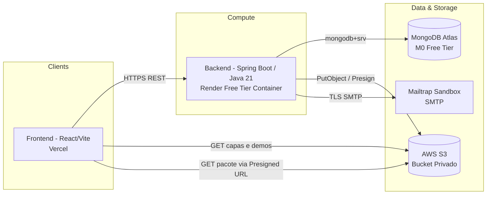

# AGENT_CONTEXT.md — Sonic Lab Backend

> **Documento de Continuidade Operacional para Agentes de IA e Engenharia**  
> **Última atualização:** 24/11/2026  
> **Status do projeto:** Fase 1 (Auditoria e Diagnóstico) e Fase 2 (Consolidação de Decisões) concluídas. Fase 3 (Implementação) aguarda autorização explícita (`PODE IMPLEMENTAR`). Nenhum arquivo de código foi alterado até o momento.

---

## 1. Visão Geral do Projeto

O **Sonic Lab** é um marketplace e ecossistema digital voltado para produtores musicais, beatmakers e criadores de áudio comercializarem e consumirem *Sound Kits* (drum kits, sample packs, loops, presets e one-shots).

### Tecnologias Principais

| Componente | Stack Tecnológica |
|---|---|
| **Backend** | Java 21, Spring Boot 4.1.1, Gradle 9.7.1 (Wrapper), Spring Security, Spring Data MongoDB, SpringDoc OpenAPI 3.1.1 |
| **Frontend** | React + Vite (repositório GitHub separado) |
| **Banco de Dados** | MongoDB (Local via Docker Compose em dev; MongoDB Atlas em prod) |
| **Armazenamento de Arquivos** | Local filesystem (dev) / AWS S3 via AWS SDK 2.56.0 (prod) |
| **Processamento de Áudio** | JAVE 3.5.0 (`ws.schild:jave-all-deps`), JLayer 1.0.1, MP3SPI 1.9.5.4, VorbisSPI 1.0.3.3, JFLAC 1.5.2 |
| **Autenticação** | JWT stateless via Auth0 `java-jwt:4.6.0` com HMAC256 |
| **E-mail** | Spring Boot Starter Mail (SMTP Mailtrap Sandbox) |

### Comunicação entre Serviços

- Frontend (React) consome a API RESTful do backend via HTTPS.
- Uploads de mídia ocorrem em duas etapas:
  1. Frontend envia arquivos brutos aos endpoints de upload dedicados (`/soundkits/uploads/*`).
  2. Backend processa, armazena no storage ativo e devolve referências (URLs públicas ou object keys).
  3. Frontend submete o payload final de cadastro em `POST /soundkits`.
- Downloads de pacotes pagos são protegidos por autenticação JWT e servidos exclusivamente via URLs pré-assinadas (Presigned URLs S3) geradas sob demanda com TTL.

---

## 2. Ambiente e Execução Local

### Requisitos e Versões

- **JDK:** Java 21 (Toolchain configurada no Gradle: `JavaLanguageVersion.of(21)`).
- **Gradle:** 9.7.1 via Gradle Wrapper (`gradlew`, `gradlew.bat`).
- **Build Tool:** Plugin Spring Boot `4.1.1`, Freefair Lombok `9.5.0`, AWS SDK BOM `2.56.0`.

### MongoDB Local & Docker Compose

Arquivo [`docker-compose.yml`](file:///C:/Users/T-GAMER/Documents/Programacao/SONIC_LABfiles/SONIC_LAB/sonic-lab-back-end/docker-compose.yml):
- Serviço `mongodb`: imagem `mongo:latest`, porta mapeada `27017:27017`.
  - Usuário root: `admin`, senha: `password`, database: `soniclab_db`.
  - Volume persistente: `mongo_data`.
- Serviço `mongo-express`: imagem `mongo-express:latest`, porta mapeada `8081:8081`.

### Armazenamento Local

- Controlado por `storage.type=local` (implementação [`LocalStorageService`](file:///C:/Users/T-GAMER/Documents/Programacao/SONIC_LABfiles/SONIC_LAB/sonic-lab-back-end/src/main/java/com/soniclab/soniclabbackend/soundkit/storage/LocalStorageService.java)).
- Diretório padrão: `./uploads` (ignorado no `.gitignore`).
- Base URL: `http://localhost:8080/uploads/`.
- Mapeamento estático ativo via [`WebStorageConfig`](file:///C:/Users/T-GAMER/Documents/Programacao/SONIC_LABfiles/SONIC_LAB/sonic-lab-back-end/src/main/java/com/soniclab/soniclabbackend/soundkit/storage/WebStorageConfig.java) (anotado com `@ConditionalOnProperty(name = "storage.type", havingValue = "local", matchIfMissing = true)`).

### Comandos de Execução e Testes

```powershell
# Subir infraestrutura de banco de dados
docker compose up -d

# Executar a aplicação localmente
./gradlew bootRun

# Executar a suíte de testes automatizados
./gradlew clean test

# Gerar o artefato executável de produção
./gradlew bootJar
```

---

## 3. Arquitetura do Backend

### Organização de Pacotes

```
com.soniclab.soniclabbackend
├── SonicLabBackEndApplication.java    # Ponto de entrada (@SpringBootApplication, @EnableAsync)
├── config/
│   ├── MongoConfig.java               # Habilita auditoria e registra MongoCustomConversions
│   ├── MongoConverter.java            # Interface base para conversores customizados
│   └── OpenAPIConfig.java             # Documentação OpenAPI/Swagger 3.1.1
├── soundkit/
│   ├── config/                        # SoundKitBeforeConvertCallback, SoundKitMongoConverters
│   ├── controller/
│   │   ├── SoundKitController.java         # CRUD de kits, busca pública, tags, download
│   │   └── SoundKitUploadController.java   # Endpoints de upload: /package, /cover, /demo
│   ├── dto/
│   │   ├── request/                   # CreateSoundKitRequest, UpdateSoundKitRequest, SoundKitFilterParams
│   │   └── response/                  # SoundKitResponse, SoundKitUploadResponse, SoundKitDownloadResponse, PageResponse
│   ├── entity/                        # SoundKit (@Document), SoundKitId, AudioDemo (record), KitType (enum)
│   ├── exception/                     # SoundKitNotFoundException
│   ├── repository/                    # SoundKitRepository (Spring Data MongoDB)
│   ├── service/
│   │   ├── SoundKitService.java       # Regras de negócio, busca, criação, normalização de keys
│   │   └── SoundKitFileProcessor.java # Validação ZIP, conversão MP3, análise PCM e waveform
│   └── storage/
│       ├── FileStorageService.java    # Interface pública de armazenamento
│       ├── FileVisibility.java        # Enum (PUBLIC, PRIVATE)
│       ├── LocalStorageService.java   # Armazenamento em disco local para dev
│       ├── S3StorageService.java      # Armazenamento AWS S3 para prod
│       ├── AwsS3Config.java           # Configuração de beans S3Client e S3Presigner
│       └── WebStorageConfig.java      # ResourceHandler /uploads/** para LocalStorageService
└── user/
    ├── config/
    │   ├── AuthConfig.java            # UserDetailsService para Spring Security
    │   ├── JWTUserData.java           # Record com claims do token autenticado
    │   ├── RateLimitingFilter.java    # Rate limiting in-memory por IP (login, register, forgot-pwd)
    │   ├── SecurityConfig.java        # SecurityFilterChain, CORS, PasswordEncoder (BCrypt)
    │   ├── SecurityFilter.java        # Filtro JWT OncePerRequestFilter
    │   ├── TokenConfig.java           # Geração e validação de tokens JWT (access e reset)
    │   └── UserBeforeConvertCallback.java, UserMongoConverters.java
    ├── controller/                    # AuthController (/auth/*), UserController
    ├── dto/                           # LoginRequest, RegisterUserRequest, ForgotPasswordRequest, ResetPasswordRequest, etc.
    ├── entity/                        # User (@Document, UserDetails), UserId, UserRole (USER, ADMIN)
    ├── exception/                     # GlobalExceptionHandler, ApiErrorResponse, exceções de domínio
    ├── repository/                    # UserRepository (Spring Data MongoDB)
    └── service/
        ├── AuthService.java           # Login, registro, validação e execução de reset com pwdSig
        └── EmailService.java          # Envio assíncrono (@Async) de e-mail de recuperação
```

### Autenticação e Segurança JWT

- **Token de Acesso:** expiração padrão de 24 horas, claims: `userId`, `role`, `purpose: "access"`, `sub: email`.
- **Token de Recuperação de Senha:** expiração de 30 minutos, claims: `userId`, `purpose: "password_reset"`, `pwdSig` (últimos 10 caracteres do hash BCrypt atual da senha do usuário).
- **Invalidação de Token por Assinatura (`pwdSig`):** se a senha for alterada, o hash muda e qualquer token de reset gerado anteriormente torna-se automaticamente inválido, impedindo reutilização de links.

### Abstração de Armazenamento (`FileStorageService`)

Contrato implementado por [`LocalStorageService`](file:///C:/Users/T-GAMER/Documents/Programacao/SONIC_LABfiles/SONIC_LAB/sonic-lab-back-end/src/main/java/com/soniclab/soniclabbackend/soundkit/storage/LocalStorageService.java) e [`S3StorageService`](file:///C:/Users/T-GAMER/Documents/Programacao/SONIC_LABfiles/SONIC_LAB/sonic-lab-back-end/src/main/java/com/soniclab/soniclabbackend/soundkit/storage/S3StorageService.java):
- `upload(path, in, contentLength, contentType, visibility)`: grava o arquivo e retorna a object key.
- `getPublicUrl(key)`: devolve a URL pública permanente. Lança `IllegalArgumentException` se chamado para arquivo privado no S3.
- `generateDownloadUrl(key)` / `generateDownloadUrl(key, ttl)`: devolve URL temporária (Presigned no S3; URL pública no LocalStorage).
- `delete(keyOrUrl)`: remove o objeto.
- `exists(keyOrUrl)`: verifica presença do objeto.
- `isPublic(keyOrUrl)`: valida visibilidade via prefixo (`/covers/`, `/demos/` = PUBLIC; demais = PRIVATE).

### Fluxos de Upload e Mídia

1. **Package ZIP (`POST /soundkits/uploads/package`):**
   - Aceita ZIP único ou lista de arquivos soltos compactados em runtime.
   - Valida Zip Slip e Zip Bomb (`MAX_ZIP_ENTRIES = 1000`, `MAX_ZIP_UNCOMPRESSED_BYTES = 2GB`).
   - Salvo sob prefixo `soundkits/packages/{UUID}.zip` com `FileVisibility.PRIVATE`.
   - Retorna `SoundKitUploadResponse(fileKey, fileUrl, totalBytes, totalSamples)`.
   - **`fileUrl` retornado é idêntico à `fileKey`** (ex: `soundkits/packages/xyz.zip`).

2. **Capa (`POST /soundkits/uploads/cover`):**
   - Upload de imagem (PNG, JPG, WEBP).
   - Salvo sob prefixo `soundkits/covers/{UUID}{ext}` com `FileVisibility.PUBLIC`.
   - Retorna `{"coverUrl": "https://..."}`.

3. **Áudio Demo (`POST /soundkits/uploads/demo`):**
   - Aceita WAV, MP3, AIFF, FLAC, OGG (limite original no código: 100MB).
   - Se formato não-MP3: transcodifica para MP3 estéreo 192 kbps 44.1 kHz via JAVE/FFmpeg (`libmp3lame`).
   - Salvo sob prefixo `soundkits/demos/{UUID}.mp3` com `FileVisibility.PUBLIC`.
   - Análise de áudio em streaming (blocos de 256 frames): calcula duração exata e extrai 100 pontos normalizados de RMS (0.0 a 1.0).
   - Retorna `AudioDemo(url, durationInSeconds, waveformData)`.
   - **`AudioDemo.url` armazena a URL pública permanente** (ex: `https://bucket.s3.region.amazonaws.com/...`).

4. **Persistência do Kit (`POST /soundkits`):**
   - [`SoundKitService.create()`](file:///C:/Users/T-GAMER/Documents/Programacao/SONIC_LABfiles/SONIC_LAB/sonic-lab-back-end/src/main/java/com/soniclab/soniclabbackend/soundkit/service/SoundKitService.java#L79) executa `normalizeFileKey(request.fileUrl())`.
   - Garante que mesmo se o cliente enviar uma URL completa ou com localhost, o MongoDB persiste **exclusivamente a chave relativa estável** (`soundkits/packages/xyz.zip`).
   - `SoundKitResponse` nunca expõe o pacote privado (campo `fileUrl` omitido do DTO público).

5. **Download Seguro (`GET /soundkits/{id}/download`):**
   - Endpoint autenticado.
   - Localiza o kit ativo, recupera a key estável e gera Presigned URL no S3 (TTL padrão 15 min).
   - Retorna `SoundKitDownloadResponse(downloadUrl, expiresInSeconds: 900)`.

---

## 4. Arquitetura de Produção Planejada



### Destinos e Responsabilidades

| Componente | Plataforma | Configuração / Conexão |
|---|---|---|
| **Frontend** | Vercel | Aponta chamadas de API para o domínio Render |
| **Backend** | Render (Web Service Docker) | Conecta a Atlas, S3 e Mailtrap via env vars |
| **Banco de Dados** | MongoDB Atlas (Cluster M0) | Conexão via `MONGODB_URI` (`mongodb+srv://...`) |
| **Arquivos Privados** | AWS S3 (`soundkits/packages/*`) | Acesso exclusivo via S3Presigner |
| **Arquivos Públicos** | AWS S3 (`soundkits/covers/*`, `soundkits/demos/*`) | Leitura pública direta via Bucket Policy restrita |
| **E-mails Transacionais** | Mailtrap Sandbox | SMTP host, port, username, password |

### Mapeamento de Variáveis de Ambiente

| Variável | Obrigatoriedade em Prod | Descrição / Exemplo |
|---|---|---|
| `PORT` | Automática (Render) | Porta HTTP injetada pela plataforma (ex: 10000) |
| `MONGODB_URI` | **Sim** | `mongodb+srv://<user>:<pwd>@cluster.mongodb.net/soniclab_db?retryWrites=true&w=majority` |
| `JWT_SECRET` | **Sim** | Segredo aleatório de 256 bits (ex: `openssl rand -base64 64`) |
| `JWT_EXPIRATION_HOURS` | Não (default: 24) | Tempo de vida do access token |
| `JWT_ISSUER` | Não (default: `sonic-lab-api`) | Emissor do token |
| `FRONTEND_URL` | **Sim** | Domínio do frontend no Vercel (ex: `https://sonic-lab.vercel.app`) |
| `STORAGE_TYPE` | **Sim** | `s3` |
| `S3_BUCKET` | **Sim** | Nome do bucket AWS S3 |
| `AWS_REGION` | **Sim** | Região AWS (ex: `us-east-2`) |
| `AWS_ACCESS_KEY_ID` | **Sim** (sem IAM Role) | Credencial IAM com menor privilégio |
| `AWS_SECRET_ACCESS_KEY` | **Sim** (sem IAM Role) | Credencial IAM com menor privilégio |
| `S3_URL_DURATION_MINUTES`| Não (default: 15) | Validade das Presigned URLs de download |
| `S3_PUBLIC_BASE_URL` | Não | Opcional (se utilizar CDN/CloudFront) |
| `MAIL_HOST` | Não (default: Mailtrap) | Host SMTP |
| `MAIL_PORT` | Não (default: 587 ou 2525) | Porta SMTP |
| `MAIL_USERNAME` | Sim (se envio ativo) | Credencial Mailtrap |
| `MAIL_PASSWORD` | Sim (se envio ativo) | Credencial Mailtrap |
| `MAIL_FROM` | Não | Remetente padrão |

### Particularidades do Render Free Tier

1. **Inatividade / Sleep (Spin Down):** o serviço entra em suspensão após 15 minutos sem requisições. O primeiro acesso subsequente tem latência de inicialização fria (*cold start*) de 30 a 60 segundos.
2. **Timeout HTTP:** limite estrito de 30 segundos por requisição. Operações síncronas que ultrapassarem esse tempo são abortadas com HTTP 504.
3. **Memória RAM Limitada (512 MB):** o container compartilha memória total entre SO, JVM e subprocessos nativos (FFmpeg).
4. **Filesystem Efêmero:** arquivos em `/tmp` persistem apenas durante a vida do container e são reinicializados em novos deploys.

---

## 5. Decisões Técnicas Já Estabelecidas

> **Atenção:** as decisões abaixo foram aprovadas e **NÃO** devem ser reabertas ou modificadas sem autorização explícita do usuário:

1. **Manter o ambiente local 100% funcional:** `docker compose`, `bootRun`, `LocalStorageService` e `./gradlew test` devem continuar executando sem exigir AWS ou internet.
2. **Preservar o contrato público de `FileStorageService`:** não alterar assinaturas dos métodos existentes.
3. **Persistência de `SoundKit.fileUrl`:** continua armazenando a **object key estável** (`soundkits/packages/xyz.zip`), nunca URLs completas ou temporárias.
4. **Persistência de `AudioDemo.url`:** continua armazenando a **URL pública completa** (conforme validado por `@Pattern(regexp = "^https?://\\S+$")` e consumido pelo React).
5. **Privacidade de Packages:** pacotes ZIP permanecem estritamente privados com `FileVisibility.PRIVATE` e acesso exclusivo por Presigned URLs sob demanda.
6. **Acesso a Covers e Demos:** acesso público direto via URL permanente do S3, viabilizado por Bucket Policy restrita exclusivamente aos prefixos `soundkits/covers/*` e `soundkits/demos/*`.
7. **Segurança AWS:** não tornar o bucket inteiro público, não habilitar ACLs públicas e não desabilitar o *Block Public Access* global da conta AWS.
8. **Sem Redis:** rate limiting permanece em memória (`RateLimitingFilter`).
9. **Sem RabbitMQ / Mensageria:** processamento de áudio permanece síncrono no backend nesta etapa.
10. **Sem migração de dados legados:** banco do MongoDB Atlas começará vazio em produção.
11. **Sem refatorações fora do escopo:** focar estritamente nas adaptações necessárias para containerização e publicação estável.

---

## 6. Problemas Identificados e Pendências

### A. Problemas Confirmados (Necessitam Correção Obrigatória)

| ID | Descrição | Localização | Ação Necessária |
|---|---|---|---|
| **P1** | **Vulnerabilidade no reset de senha:** `AuthController.resetPassword()` invoca `tokenConfig.validateToken()` em vez de delegar para `AuthService.resetPassword()`. Com isso, tokens com `purpose="access"` conseguem redefinir senha e a assinatura `pwdSig` não é conferida, permitindo reutilização de tokens. | [`AuthController.java:92-116`](file:///C:/Users/T-GAMER/Documents/Programacao/SONIC_LABfiles/SONIC_LAB/sonic-lab-back-end/src/main/java/com/soniclab/soniclabbackend/user/controller/AuthController.java#L92-L116) | Delegar a execução para `AuthService.resetPassword()`, que já valida `purpose="password_reset"` e `pwdSig`. |
| **P2** | **Insegurança do segredo JWT:** `application.properties` possui valor default de desenvolvimento para `api.security.token.secret`. Em produção, a aplicação deve falhar no startup se o segredo for fraco, nulo ou o padrão de dev. | [`application.properties:33`](file:///C:/Users/T-GAMER/Documents/Programacao/SONIC_LABfiles/SONIC_LAB/sonic-lab-back-end/src/main/resources/application.properties#L33) | Implementar validador fail-fast no startup exigindo segredo forte (≥256 bits) e diferente do padrão de dev quando em produção. |
| **P3** | **Default divergente de `storage.type`:** `application.properties` define `${STORAGE_TYPE:s3}` enquanto `.env.example` define `local`. Sem variável explícita, a aplicação local tenta conectar ao S3 e falha. | [`application.properties:66`](file:///C:/Users/T-GAMER/Documents/Programacao/SONIC_LABfiles/SONIC_LAB/sonic-lab-back-end/src/main/resources/application.properties#L66) | Ajustar default para `${STORAGE_TYPE:local}` no `application.properties`. Produção definirá `STORAGE_TYPE=s3`. |
| **P4** | **Inexistência de endpoint de Health Check:** o Render necessita de rota HTTP leve para monitoramento de liveness e readiness. | — | Criar `HealthController` com endpoint público `GET /health` respondendo `{"status":"UP"}` e liberá-lo no `SecurityConfig`. |
| **P5** | **Ausência de Dockerfile e `.dockerignore`:** impede o build e deploy na plataforma Render. | Raiz do repositório | Criar Dockerfile multi-stage (build JDK 21 / runtime JRE 21) e `.dockerignore`. |

### B. Riscos Técnicos que Precisam ser Validados em Runtime

| ID | Risco | Mitigação Planejada |
|---|---|---|
| **R1** | **Compatibilidade do JAVE/FFmpeg nativo em container Linux:** `jave-all-deps:3.5.0` extrai binário FFmpeg para `/tmp`. Se `/tmp` tiver flag `noexec`, a conversão falha. | Testar execução do container Docker com arquivo WAV real. Imagem base Jammy/Debian garante `/tmp` executável. |
| **R2** | **Timeout de 30s do Render durante conversão de áudio:** WAVs grandes transcodificados para MP3 podem exceder 30 segundos de CPU compartilhada no Render. | Reduzir `MAX_DEMO_BYTES` de 100MB para 20MB em [`SoundKitFileProcessor.java`](file:///C:/Users/T-GAMER/Documents/Programacao/SONIC_LABfiles/SONIC_LAB/sonic-lab-back-end/src/main/java/com/soniclab/soniclabbackend/soundkit/service/SoundKitFileProcessor.java#L70). |
| **R3** | **Estouro de memória (OOM 512MB) no Render:** processamento simultâneo de áudio e descompactação de ZIPs grandes pode ultrapassar 512MB de RAM. | Configurar flags JVM no container (`-XX:MaxRAMPercentage=75.0`, `-XX:+ExitOnOutOfMemoryError`) e manter processamento estritamente síncrono. |
| **R4** | **Porta SMTP bloqueada no Render:** alguns provedores de nuvem bloqueiam porta 587 de saída. | Configurar fallback documentado para porta `2525` do Mailtrap caso a porta `587` sofra timeout. |

### C. Fatos Confirmados vs. Hipóteses Esclarecidas

- **Confirmado:** `@EnableAsync` **já está presente** em [`SonicLabBackEndApplication.java`](file:///C:/Users/T-GAMER/Documents/Programacao/SONIC_LABfiles/SONIC_LAB/sonic-lab-back-end/src/main/java/com/soniclab/soniclabbackend/SonicLabBackEndApplication.java). O diagnóstico inicial de que faltava `@EnableAsync` foi corrigido.
- **Confirmado:** `@Async` utiliza o `SimpleAsyncTaskExecutor` padrão do Spring (sem pool limitado). Como o volume de reset de senha é baixo, não há necessidade de adicionar executor complexo nesta fase.
- **Confirmado:** `RateLimitingFilter` extrai o IP real através do header `X-Forwarded-For`, sendo plenamente compatível com o proxy reverso do Render.

---

## 7. Plano de Implementação (Fase 3)

A execução seguirá esta ordem sequencial estrita após aprovação:

```
Passo 1: Correção de Segurança em AuthController (P1)
   └── Delegar forgotPassword() e resetPassword() para AuthService
   └── Garantir mapeamento de exceções e testes unitários

Passo 2: Endpoint de Health Check e Liberação de Segurança (P4)
   └── Criar HealthController.java (GET /health)
   └── Liberar /health no SecurityConfig.java sem autenticação

Passo 3: Validação Fail-fast de JWT e Ajuste de Configurações (P2, P3, R2)
   └── Adicionar validação de JWT_SECRET forte em produção
   └── Ajustar storage.type=${STORAGE_TYPE:local} em application.properties
   └── Reduzir MAX_DEMO_BYTES para 20MB em SoundKitFileProcessor.java
   └── Atualizar .env.example com variáveis S3 e Atlas documentadas

Passo 4: Criação do Dockerfile e .dockerignore (P5)
   └── Dockerfile multi-stage: eclipse-temurin:21-jdk -> eclipse-temurin:21-jre
   └── Configurar usuário não-root, diretório de trabalho, variáveis e entrypoint otimizado
   └── .dockerignore excluindo build, git, .env, uploads locais

Passo 5: Criação da Suíte de Testes de Segurança de Autenticação
   └── Criar AuthControllerSecurityTest.java validando as 5 regras de reset de senha

Passo 6: Documentação de Deploy (DEPLOY.md)
   └── Passo a passo para Render, Atlas, S3 Bucket Policy e Vercel
```

---

## 8. Testes e Validações

### 1. Testes Locais Automatizados (Executáveis sem nuvem)
- `./gradlew clean test`:
  - `SoundKitServiceTest`: validação de regras de kits e normalização de chaves.
  - `SoundKitFileProcessorTest`: waveform real MP3/WAV, transcodificação, tolerância a falhas.
  - `StorageConfigurationIntegrationTest`: alternância condicional de beans (`local` vs `s3`).
  - `LocalStorageServiceTest`: CRUD em disco, path traversal security.
  - `AuthControllerSecurityTest` (novo): validação de isolamento de tokens e `pwdSig`.

### 2. Testes de Build e Empacotamento
- `./gradlew bootJar`: valida compilação limpa e empacotamento do JAR executável.

### 3. Testes de Container Docker Local
- `docker build -t sonic-lab-backend:test .`: validação do build multi-stage.
- `docker run --rm -p 8080:8080 -e STORAGE_TYPE=local sonic-lab-backend:test`:
  - Teste de chamada: `curl http://localhost:8080/health` (deve retornar 200 OK).
  - Validação de ausência de erros de extração nativa do JAVE/FFmpeg no Linux.

### 4. Testes de Integração com Serviços Reais (Pós-configuração manual)
- **MongoDB Atlas:** conexão inicial via URI com TLS e criação automática de coleções/índices.
- **AWS S3:**
  - Upload de demo/cover e verificação de leitura pública via browser.
  - Upload de pacote ZIP e verificação de bloqueio público direto (HTTP 403 esperado).
  - Geração de Presigned URL e download autenticado bem-sucedido.
- **Frontend Vercel:** teste de fluxo pontual via interface web sem bloqueios de CORS.

---

## 9. Histórico de Progresso

| Data | Etapa | Descrição / Resultado |
|---|---|---|
| **24/11/2026** | **Fase 1: Auditoria Técnica** | Inspeção detalhada de 100% dos pacotes, controllers, services, configurações e testes. Identificação dos problemas P1 a P5 e riscos R1 a R4. |
| **24/11/2026** | **Fase 2: Consolidação** | Definição das decisões arquiteturais imutáveis (S3 menor privilégio, 20MB demos, URL completa em AudioDemo, object key em SoundKit). |
| **24/11/2026** | **Documentação de Contexto** | Criação deste `AGENT_CONTEXT.md` na raiz do backend para servir de base às próximas sessões. |
| **Pendente** | **Fase 3: Implementação** | **Aguardando confirmação expressa: `PODE IMPLEMENTAR`.** |
